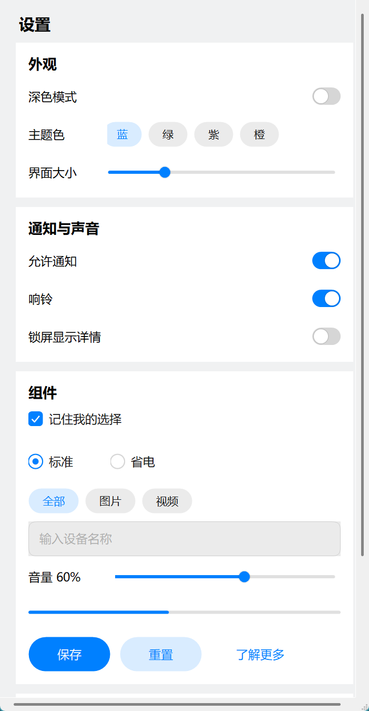
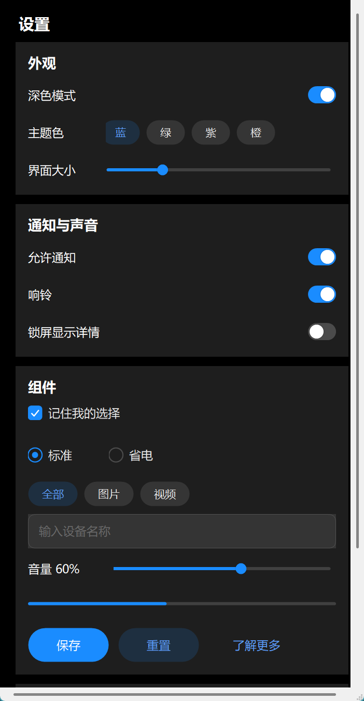

# CouiSharp

A ColorOS 17 (COUI) styled control library for **WinForms**, written in pure C#. It is a
**separate library** from [MiuixSharp-WinForms](https://github.com/Jonah-77/MiuixSharp-WinForms):
different namespace (`CouiSharp`), different repository, different version line. The two only
share engineering conventions (DPI maths, self-painted surfaces), not code or design tokens.




## Why it looks the way it does

The visual language is taken from **COUI**, the Compose Multiplatform ColorOS 17 theme
([suqi8/coui](https://github.com/suqi8/coui), Apache-2.0). The tokens implemented here were read
from that project's sources and re-theme spec:

| Area | Value | Token / source |
| --- | --- | --- |
| Accent | `#0080FF` light / `#1A8CFF` dark | `primary`, `containerTheme` |
| Page | `#F0F1F2` light / `#000000` dark | `backgroundWithCard` |
| Card | `#FFFFFF` light / `#1E1E1E` dark | `card` |
| Text | 90% / 54% / 26% black (inverse in dark) | `labelPrimary`, `labelSecondary`, `labelTertiary` |
| Dividers | 12% black, 15% white in dark | `divider` |
| Card radius | **12dp** | card token |
| Button | **capsule**, 44dp tall (radius 21.5dp) | button spec |
| Input | **10dp** radius, 44dp tall | text field spec |
| Switch | **36 × 22dp**, 18dp thumb | switch spec |
| Slider | 20dp min height, 4dp track | slider spec |
| Type | 15sp body, 13sp caption, 18sp header, 20sp title | `TextStyles.kt` |
| Shape | squircle, continuous curvature | `coui-squircle` |

Success / warning / error use `#00BD13`, `#FF7700` and `#E82A18`; the semantic set also carries
`red` `#EB3B2F`, `orange`, `yellow` and `green` so a host can express state without inventing
colors.

## Controls

| Control | What it is |
| --- | --- |
| `CouiCard` | 12dp squircle container on the page color; optional hairline and press feedback |
| `CouiButton` | Capsule action: `Primary`, `Tonal`, `Text`, `Danger` |
| `CouiSwitch` | 36 × 22dp switch with an 18dp thumb |
| `CouiCheckBox` | 18dp squircle box with a drawn tick |
| `CouiRadioButton` | 18dp ring, `GroupName` unchecks siblings |
| `CouiChip` | 32dp checkable filter chip |
| `CouiTextBox` | 10dp field with a real `TextBox` inside (IME, selection, caret stay native) |
| `CouiSlider` | 4dp track, accent fill, keyboard support |
| `CouiProgressBar` | 4dp capsule, determinate and indeterminate |
| `CouiDivider` | 1dp rule with the 16dp leading inset |
| `CouiLabel` | Text primitive so labels never leave stale pixels on a painted card |

## Quick start

```csharp
using CouiSharp.Controls;
using CouiSharp.Theme;

CouiTheme.Mode = CouiThemeMode.Dark;          // or System / Light
CouiTheme.SeedColor = Color.FromArgb(0xFF, 0x00, 0xBD, 0x13); // optional accent override

var card = new CouiCard { Bounds = new Rectangle(16, 16, 400, 160) };
var title = new CouiLabel { Text = "外观", Font = CouiTypography.Header(), Bounds = new Rectangle(16, 12, 360, 28) };
var toggle = new CouiSwitch { Checked = true, Location = new Point(340, 60) };
var save = new CouiButton { Text = "保存", Variant = CouiButtonVariant.Primary, Location = new Point(16, 100) };

card.Controls.AddRange(new Control[] { title, toggle, save });
Controls.Add(card);
```

The demo in `samples/CouiSharp.Demo` is the same page shape as a ColorOS settings screen and
accepts `--dark`, `--light` and `--accent=green|purple|orange|teal` so visual states can be
reproduced without clicking.

## Design rules the controls follow

1. **No `Region` clipping for rounded corners.** At 125–150% DPI a clipped region aliases into a
   dashed edge. Every control paints its own squircle path instead.
2. **Paint the backdrop first.** `CouiBackdrop.Resolve` walks the parent chain (including custom
   surfaces exposed through `SurfaceColor`), so a rounded corner never shows a foreign color.
3. **Never declare `ControlStyles.Opaque`.** It would skip the backdrop fill; the library fills a
   double-buffered surface instead.
4. **Flatten translucent text colors.** GDI's text renderer does not blend alpha reliably, so
   tokens such as a 26% label are composited with the surface before drawing.
5. **Metrics are recomputed, not baked.** `ApplyMetrics()` runs on handle creation, DPI change,
   theme change and resize.
6. **dp everywhere.** `CouiTheme.Dp(control, dp)` = dp × (monitor DPI / 96) × user scale; fonts use
   points, which GDI already scales, so they only follow the user scale.

## Build

```
dotnet build CouiSharp.sln
dotnet run --project samples/CouiSharp.Demo
```

Targets `net8.0-windows` and `net6.0-windows`. The demo targets `net8.0-windows` and is
PerMonitorV2 aware.

## Known limits

- Controls are **self-painted**, not native wrappers; a `CouiTextBox` hosts a borderless native
  `TextBox` but everything else is drawn by the library.
- No composition/backdrop blur, no shader-based squircle, no navigation stack — those are COUI
  modules that need effects WinForms cannot cheaply provide.
- High contrast mode is not wired into the token layer yet; `CouiTheme` exposes the switch point.

## Credits and license

Design tokens are derived from **COUI** (Copyright the COUI contributors, Apache-2.0) and from the
ColorOS 17 design language. This library ships under the MIT license; see `LICENSE` and `NOTICE`.

Not affiliated with OPPO / ColorOS. ColorOS is a trademark of its owner.
